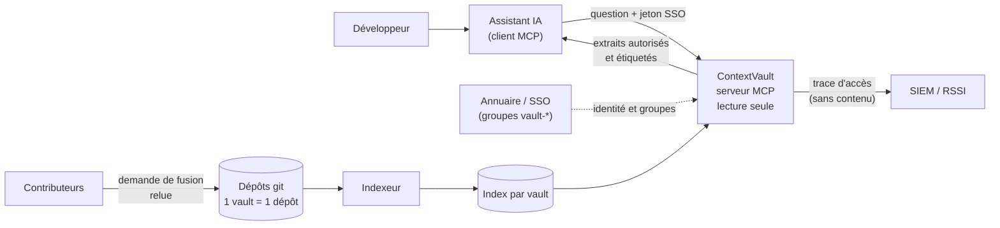
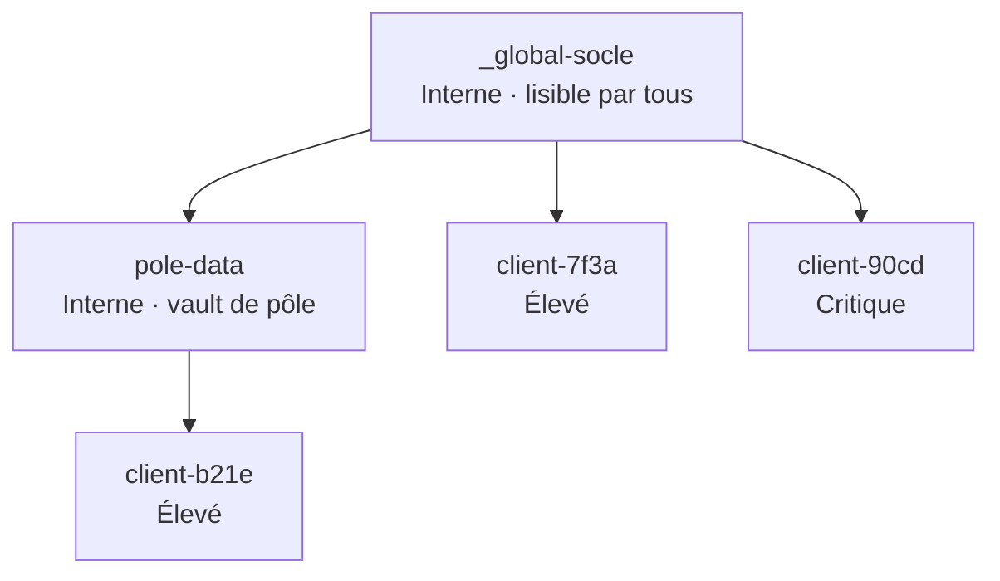
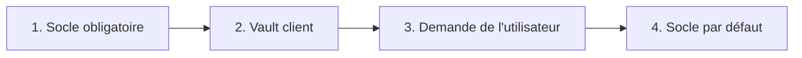
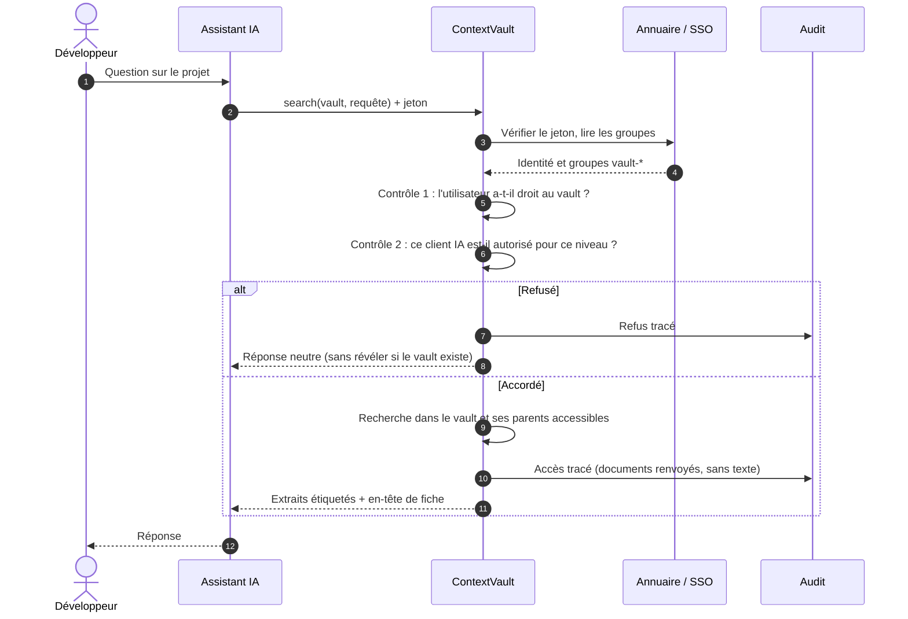
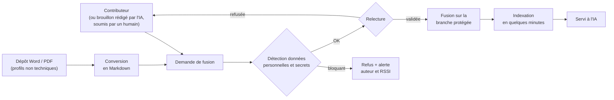
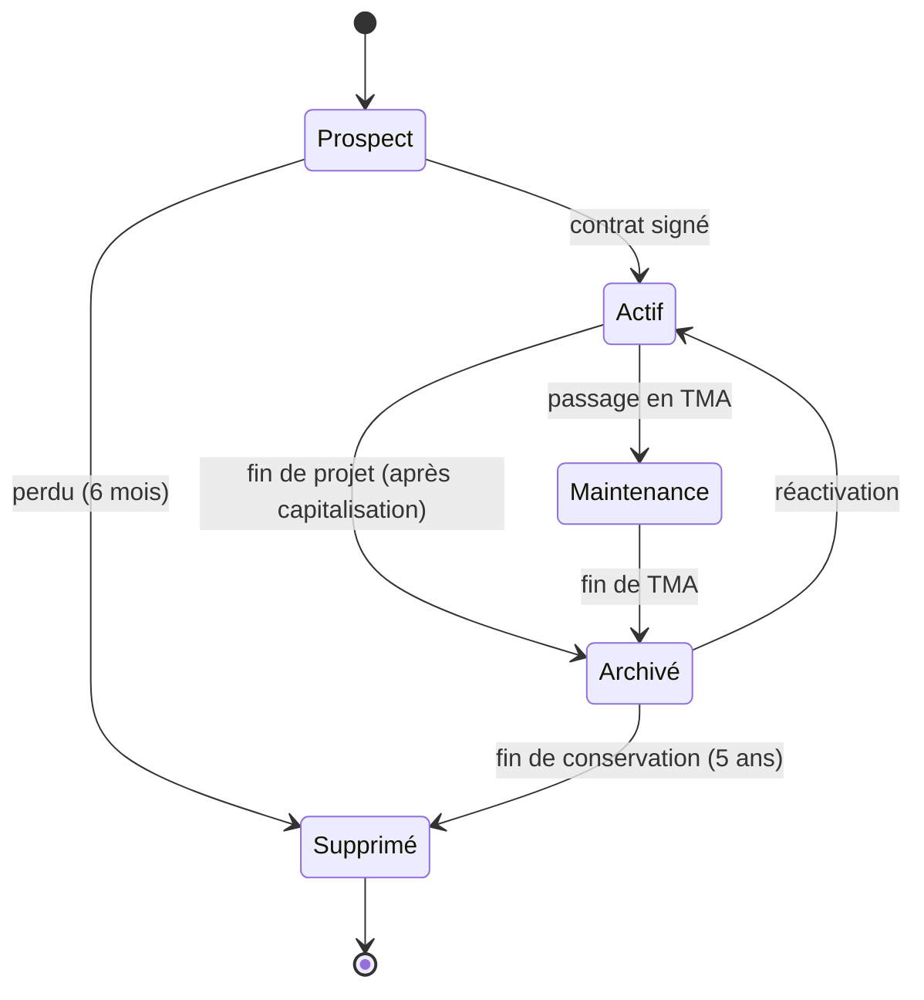
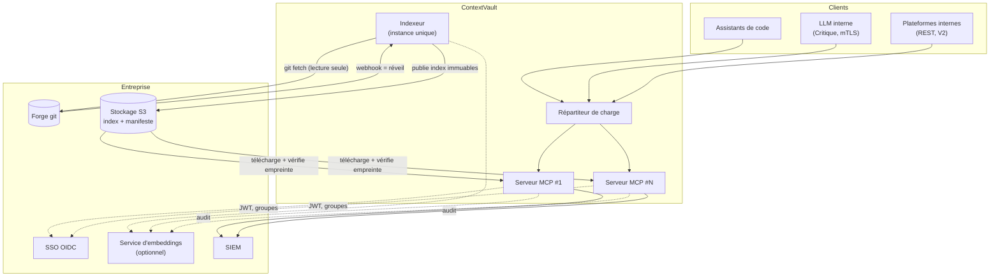
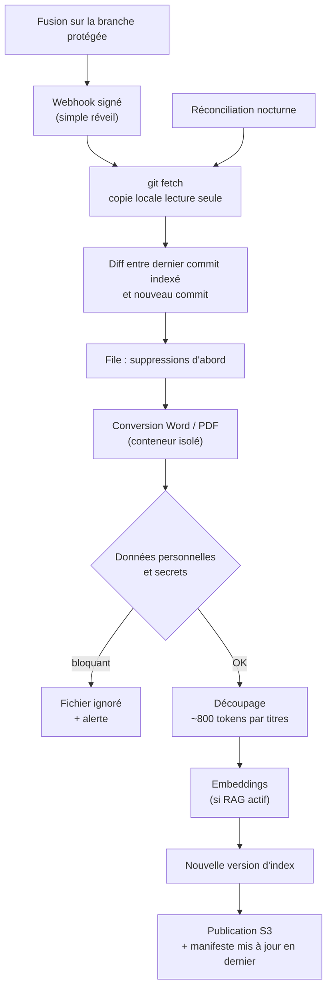
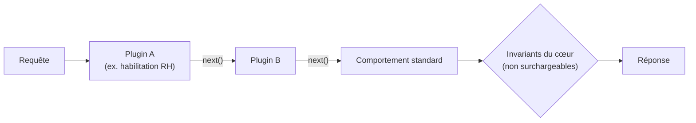
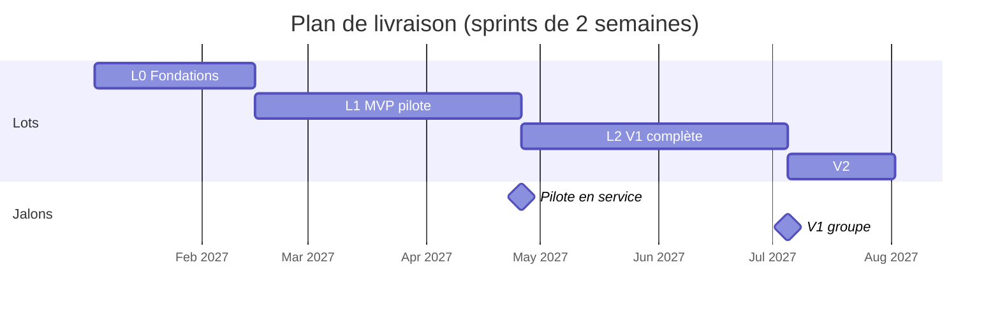

# ContextVault — Cahier des charges

**Banque de contextes multi-vaults pour assistants IA, avec héritage, cloisonnement et lecture seule**

| | |
|---|---|
| Version | 6.0 |
| Date | 11/11/2026 |
| Statut | Validé en revue (décisions Q1 à Q20 et T1 à T21) |
| Documents liés | [Décisions fonctionnelles](decisions-fonctionnelles.md) · [Décisions techniques](decisions-techniques.md) · [Backlog](backlog/) |

### Historique

| Version | Date | Changement |
|---|---|---|
| 4.0 | — | Version initiale soumise à revue |
| 5.0 | 10/11/2026 | Intégration des 20 décisions fonctionnelles |
| 5.1 | 11/11/2026 | Extensions par plugins composables (T17) |
| 5.2 | 11/11/2026 | Intégration des 21 décisions techniques et du plan de livraison |
| 6.0 | 11/11/2026 | Refonte du document : exigences numérotées, schémas, traçabilité. Aucun changement de fond par rapport à la 5.2 |

---

## Sommaire

1. [Présentation](#1-présentation)
2. [Acteurs](#2-acteurs)
3. [Vue d'ensemble](#3-vue-densemble)
4. [Exigences fonctionnelles](#4-exigences-fonctionnelles)
5. [Règles de gestion](#5-règles-de-gestion)
6. [Architecture technique](#6-architecture-technique)
7. [Exigences techniques](#7-exigences-techniques)
8. [Extensions](#8-extensions)
9. [Configuration](#9-configuration)
10. [Exigences non fonctionnelles](#10-exigences-non-fonctionnelles)
11. [Recette et tests](#11-recette-et-tests)
12. [Périmètre et plan de livraison](#12-périmètre-et-plan-de-livraison)
13. [Paramètres réglables](#13-paramètres-réglables)
14. [Annexe : traçabilité des décisions](#14-annexe--traçabilité-des-décisions)

Conventions : les exigences sont numérotées `EF-xx` (fonctionnelles), `ET-xx` (techniques) et `ENF-xx` (non fonctionnelles). Les règles de gestion sont numérotées `RG-xx` ; chacune fait l'objet d'au moins un test (§11).

---

## 1. Présentation

### 1.1 Contexte

Dans une ESN, les équipes travaillent en parallèle sur des projets clients cloisonnés. Chaque projet a sa documentation propre (spécifications, architecture, retours d'expérience) et s'appuie sur un socle commun (standards, sécurité, templates). Les assistants IA des développeurs ont besoin de ce contexte, sans jamais mélanger les clients.

### 1.2 Objectif

ContextVault expose aux assistants IA, via le protocole MCP (et une API REST en V2), une banque de contextes qui est :

| Propriété | Ce que cela garantit |
|---|---|
| **Cloisonnée** | Une personne ne voit que les vaults de ses projets ; droits issus de l'annuaire de l'entreprise |
| **Hiérarchique** | Un vault client hérite du socle commun et des vaults intermédiaires, sans copie |
| **En lecture seule** | L'IA consulte ; seuls des humains modifient le contenu, après relecture |
| **Sans mémoire** | Aucune conversation n'est conservée |
| **Plug & play** | Une image Docker, une configuration minimale |
| **Extensible** | Chaque entreprise adapte des comportements par plugins, sans pouvoir affaiblir la sécurité |

### 1.3 Cible et volumétrie

Le système est dimensionné pour un grand groupe (une centaine de projets, des milliers de salariés).

| Grandeur | Cible |
|---|---|
| Vaults projets actifs | ~100 par instance |
| Documents | quelques milliers par vault, 100 000 à 500 000 au total |
| Extraits indexés | 1 à 5 millions |
| Utilisateurs | plusieurs milliers, dont 100 à 500 simultanés |
| Charge | pics de 50 à 100 requêtes/s |

Un groupe peut déployer une instance par BU ou par pays, avec un socle synchronisé entre instances.

### 1.4 Glossaire

| Terme | Définition |
|---|---|
| Vault | Ensemble de documents servis à l'IA, avec ses propres droits. Un vault = un dépôt git |
| Socle (`_global-socle`) | Vault commun à toute l'ESN : standards, sécurité, templates. Lisible par tous |
| Vault client | Vault d'un projet, réservé à l'équipe habilitée ; hérite du socle |
| Fiche contexte | Fichier `_CONTEXT.md` en tête de chaque vault : périmètre, stack, contraintes, contacts |
| Utilisateur | Personne qui interroge les vaults via son assistant IA |
| Client IA | Logiciel qui se connecte au serveur (assistant de code, chatbot, LLM interne) |
| Niveau | Niveau de confidentialité d'un vault : Interne, Élevé ou Critique |
| Extrait | Morceau de document renvoyé à l'IA (~800 tokens) |

---

## 2. Acteurs

| Acteur | Responsabilités | Ne peut pas |
|---|---|---|
| Développeur / consultant | Interroge les vaults de ses projets ; propose des modifications | Voir un vault non habilité ; faire écrire l'IA dans un vault |
| Tech lead | Relit et valide les modifications du vault de son projet | Modifier les règles obligatoires du socle |
| Chef de projet | Demande l'ouverture et la fermeture des accès ; tient la fiche contexte ; capitalise en fin de projet | Accorder lui-même un accès |
| Cellule architecture | Tient le socle ; relit ses évolutions | Voir les vaults clients dont elle n'est pas membre |
| RSSI | Valide accès, règles obligatoires et dérogations ; consulte l'audit ; reçoit les alertes | — |
| Administrateur | Crée, configure et archive les vaults | Lire un client sans en être membre (hors accès d'urgence tracé) |
| DPO | Inscrit l'outil au registre des traitements ; valide les règles sur les données personnelles | — |

---

## 3. Vue d'ensemble



Le contenu n'entre que par git, après relecture humaine. L'IA ne fait que lire, et uniquement ce que l'annuaire autorise. Chaque accès laisse une trace sans contenu.

---

## 4. Exigences fonctionnelles

### 4.1 Organisation des vaults et héritage



| Id | Exigence |
|---|---|
| EF-01 | Un vault déclare zéro, un ou plusieurs parents. La chaîne d'héritage est : le vault ciblé, puis ses parents dans l'ordre déclaré, en profondeur d'abord, sans doublon. |
| EF-02 | Héritage strict : un parent n'est inclus que si l'utilisateur y a aussi accès. L'héritage est une règle de configuration, jamais une autorisation. |
| EF-03 | Si une source héritée est filtrée, la réponse indique « N source(s) héritée(s) non accessible(s) avec vos droits », sans nom ni contenu. |
| EF-04 | Un vault ne peut pas hériter d'un vault de niveau de confidentialité supérieur au sien. |
| EF-05 | Cycles et parents inconnus sont refusés au démarrage ; un vault dont le groupe n'a pas accès à l'un de ses parents est signalé. |

### 4.2 Priorité entre socle, client et utilisateur

Les documents du socle déclarent une catégorie dans leur en-tête : `mandatory` (sécurité, légal, RGPD, secrets) ou `default` (stack, conventions, templates, outillage).



| Id | Exigence |
|---|---|
| EF-06 | Chaque extrait est étiqueté : « Règle obligatoire ESN », « Spécifique client » ou « Standard ESN, remplaçable ». L'ordre de priorité est donné à l'IA dans les instructions de connexion. |
| EF-07 | Une règle client plus stricte qu'une règle obligatoire s'applique. Une dérogation à une règle obligatoire est écrite dans `_DEROGATIONS.md`, validée par le RSSI ou l'architecte référent, et porte une date d'expiration. |
| EF-08 | Le serveur n'interprète pas le sens des textes : il étiquette et ordonne. |

### 4.3 Fiche contexte

| Id | Exigence |
|---|---|
| EF-09 | Chaque vault contient `_CONTEXT.md` à sa racine (~1 500 tokens max) : périmètre, stack, contraintes, contacts. |
| EF-10 | La fiche ne déclare ni droits ni héritage. Une section d'accès qui s'y trouverait est ignorée et signalée. |
| EF-11 | L'outil `get_vault_context` renvoie la fiche précédée d'un en-tête calculé (vault, héritage, niveau). Chaque réponse de recherche commence par un en-tête court (~100 tokens) qui rappelle la fiche. |

### 4.4 Parcours d'une question



### 4.5 Identité et droits d'accès

| Id | Exigence |
|---|---|
| EF-12 | Authentification par le SSO de l'entreprise (OIDC : Keycloak, Entra ID…). |
| EF-13 | Les rôles sont calculés côté serveur à partir des groupes de l'annuaire. Aucun rôle n'est déclaré par le client IA ni par le LLM. |
| EF-14 | Un groupe d'annuaire par vault (ex. `vault-client-7f3a`). La configuration ne référence que des groupes, jamais des personnes. |
| EF-15 | Demande d'accès par le chef de projet ; validation et exécution par l'IT ou le RSSI, via le circuit habituel. Revue trimestrielle des membres ; groupe vidé en fin de projet. |
| EF-16 | Délais de prise d'effet : ajout à la prochaine connexion ; retrait en 15 minutes au plus ; désactivation du compte effective à la requête suivante. |
| EF-17 | Aucun super-admin : un administrateur doit être membre du groupe d'un client pour en voir le contenu. Un accès d'urgence dédié existe ; chaque usage est tracé et notifié au RSSI. |
| EF-18 | Les clients IA sans OAuth (LLM locaux) utilisent un jeton personnel émis depuis un portail derrière le SSO, révocable et à durée limitée. |

### 4.6 Niveaux de confidentialité

Chaque vault déclare un niveau. **Un vault sans niveau est traité comme Élevé.**

| | Interne | Élevé | Critique |
|---|---|---|---|
| Exemples | Socle, vaults de pôle | Projet client courant | Défense, santé, données sensibles |
| Clients IA autorisés | Tous | Sous contrat entreprise, sans entraînement sur les données | LLM hébergé en interne uniquement |
| Recherche sémantique | API externe permise | Modèle interne uniquement | Modèle interne, ou désactivée |
| Audit | Refus uniquement | Tous les accès | Tous les accès + alerte sur volume anormal |
| Authentification | SSO | SSO | SSO + MFA, jetons plus courts, certificat client |
| Nom du client | — | Masqué dans identifiants et journaux | Masqué ; nom de code possible dans les réponses |

| Id | Exigence |
|---|---|
| EF-19 | Le serveur refuse de servir un vault à un client IA non autorisé pour son niveau. La liste des clients autorisés par niveau est dans la configuration. |
| EF-20 | Limite assumée : le serveur ne peut pas empêcher un copier-coller manuel. Il bloque le cas courant et le trace. Seul le niveau Critique garantit techniquement le destinataire. |

### 4.7 Identifiants neutres

| Id | Exigence |
|---|---|
| EF-21 | Tout vault client a un identifiant neutre (code court aléatoire, ex. `client-7f3a`), utilisé pour l'id, le dossier, le groupe, les logs, l'audit et le SIEM. Les vaults transverses gardent un nom lisible. |
| EF-22 | Le vrai nom figure dans `display_name` et n'est affiché qu'aux membres du groupe. Option Critique : remplacement du nom par un nom de code dans les extraits. |

### 4.8 Publication du contenu



| Ce qui change | Qui propose | Qui valide |
|---|---|---|
| Vault client | Membre de l'équipe | Tech lead ou chef de projet |
| Socle, règle par défaut | Tout salarié | Cellule architecture |
| Socle, règle obligatoire | Cellule architecture ou RSSI | RSSI |
| Dérogation d'un client | Chef de projet | RSSI ou architecte référent |

| Id | Exigence |
|---|---|
| EF-23 | Seule la branche principale protégée est indexée. Tout changement passe par une demande de fusion relue (CODEOWNERS). |
| EF-24 | Formats V1 : Markdown, texte, PDF, Word. Un fichier Word ou PDF déposé est converti et ouvre automatiquement une demande de fusion. |
| EF-25 | Les connecteurs sont des importateurs : ils déposent du Markdown qui suit le circuit normal. Jamais d'accès direct à une source externe. |
| EF-26 | L'IA peut aider à rédiger ; seul un humain soumet, sous son nom. |

### 4.9 Données personnelles (RGPD)

| Id | Exigence |
|---|---|
| EF-27 | Tolérées : coordonnées professionnelles des interlocuteurs du projet. Interdites : données des utilisateurs finaux du client (formulaires, exports, logs de production). Les jeux de données d'exemple sont fictifs. |
| EF-28 | Un fichier contenant des données personnelles au-delà d'un seuil, ou un secret, n'est pas indexé ; l'auteur et le RSSI sont alertés. |
| EF-29 | Droit à l'effacement : suppression à la source, puis purge de l'index (texte et vecteurs) en priorité. Aucune copie conservée ailleurs. |
| EF-30 | L'outil est inscrit au registre des traitements par le DPO, avec une AIPD si des vaults Critique sont concernés. |

### 4.10 Journal d'audit

| Id | Exigence |
|---|---|
| EF-31 | Une ligne par appel : date, utilisateur, client IA, action, vault, documents renvoyés (chemin et version), résultat, nombre d'extraits, latence. |
| EF-32 | Jamais le texte des questions ni des extraits. |
| EF-33 | Les refus sont tracés à tous les niveaux ; des refus répétés déclenchent une alerte RSSI. Les accès accordés par une extension alors que la règle standard les aurait refusés sont tracés à part. |
| EF-34 | Envoi en continu au SIEM ; accès réservé au RSSI ; entrées non modifiables ; conservation 6 mois à 1 an. |

### 4.11 Cycle de vie d'un vault



| État | L'IA y accède ? | Ce qui se passe |
|---|---|---|
| Prospect | Oui, équipe d'avant-vente | Appels d'offres, specs transmises |
| Actif | Oui, équipe projet | Usage normal |
| Maintenance | Oui, équipe TMA | Souvent une équipe réduite |
| Archivé | Non | Sorti de l'index ; groupe vidé ; fichiers conservés hors serveur |
| Supprimé | Non | Tout est effacé ; suppression tracée |

| Id | Exigence |
|---|---|
| EF-35 | Chaque vault porte un statut et une date de revue ; une date dépassée est signalée aux administrateurs. |
| EF-36 | Avant archivage, le chef de projet extrait les retours d'expérience utiles, anonymisés et relus, vers le socle ou un vault de pôle. |
| EF-37 | Un vault archivé est inaccessible, quelle que soit l'extension installée. La réactivation suit le circuit des accès. |

---

## 5. Règles de gestion

Chaque règle a au moins un test automatisé portant son numéro (§11).

| Domaine | Règle | Énoncé |
|---|---|---|
| Accès | RG-01 | Une personne ne voit un vault que si elle appartient à son groupe dans l'annuaire. |
| | RG-02 | Les droits sont déduits du compte d'entreprise ; ni l'assistant IA ni l'utilisateur ne peuvent les déclarer. |
| | RG-03 | Un vault inexistant et un vault interdit donnent la même réponse. |
| | RG-04 | Aucun rôle ne voit tous les clients ; l'accès d'urgence est tracé et signalé au RSSI. |
| Héritage | RG-05 | Un vault client reçoit le contenu de ses parents, sans copie. |
| | RG-06 | Un parent n'est inclus que si la personne y a accès ; sinon « N source(s) non accessible(s) », sans nom ni contenu. |
| | RG-07 | Un vault ne peut pas hériter d'un vault de niveau supérieur. |
| Priorité | RG-08 | Ordre : socle obligatoire, puis client, puis demande de l'utilisateur, puis socle par défaut. |
| | RG-09 | Une dérogation est écrite, validée par le RSSI et datée d'une expiration. |
| | RG-10 | Chaque extrait indique sa provenance : obligatoire, spécifique client ou standard remplaçable. |
| Lecture seule | RG-11 | L'IA ne peut ni créer, ni modifier, ni supprimer un document. |
| | RG-12 | Aucune question ni réponse n'est enregistrée, ni dans les vaults ni dans les journaux. |
| | RG-13 | Seul le contenu validé après relecture est servi ; un brouillon ne l'est jamais. |
| Données personnelles | RG-14 | Coordonnées professionnelles tolérées ; données des utilisateurs finaux interdites. |
| | RG-15 | Un document contenant des données personnelles en nombre n'est pas servi ; l'auteur et le RSSI sont alertés. |
| | RG-16 | Un document supprimé à la source disparaît des réponses en priorité, sans copie conservée. |
| Audit | RG-17 | Chaque accès est tracé : qui, quand, quel assistant, quel vault, quels documents, accordé ou refusé. |
| | RG-18 | Le journal ne contient jamais le texte des questions ni des extraits. |
| | RG-19 | Des refus répétés pour une même personne déclenchent une alerte au RSSI. |
| | RG-20 | Le journal est conservé 6 mois à 1 an, consultable par le seul RSSI, non modifiable. |
| Adaptation | RG-21 | Une extension ne peut pas lever la lecture seule, rouvrir un vault archivé, ignorer le niveau ni couper l'audit. |
| | RG-22 | Un accès accordé par une extension alors que la règle standard l'aurait refusé est tracé à part. |

---

## 6. Architecture technique

### 6.1 Composants



| Id | Exigence |
|---|---|
| ET-01 | Langage : TypeScript sur Node.js LTS (22+), SDK MCP officiel. |
| ET-02 | Deux processus, une base de code : serveurs MCP sans état et en lecture seule (N instances) ; indexeur, seul à écrire les index (une instance). |
| ET-03 | Les index SQLite ne sont jamais partagés sur un disque réseau. L'indexeur publie des fichiers immuables par vault dans un stockage objet compatible S3, avec un manifeste (version et empreinte). Chaque serveur consulte le manifeste (~10 s), télécharge, vérifie l'empreinte et bascule. En Docker Compose mono-machine, un dossier local suffit. |
| ET-04 | Sauvegarde : dépôts git et configuration. Les index se reconstruisent et ne sont pas sauvegardés. |

### 6.2 Chaîne d'indexation



---

## 7. Exigences techniques

### 7.1 Stockage et recherche

| Id | Exigence |
|---|---|
| ET-05 | Stockage derrière une interface. Par défaut : SQLite + FTS5, un fichier par vault (cloisonnement physique). Grands comptes (V2) : adaptateur PostgreSQL, un schéma par vault. |
| ET-06 | Recherche plein texte toujours disponible, avec racinisation française. |
| ET-07 | RAG désactivé par défaut, activable globalement puis vault par vault. Vecteurs stockés avec le texte (sqlite-vec ou pgvector). |
| ET-08 | Embeddings fournis par l'entreprise via une API compatible OpenAI ; profil Docker Compose « rag » livré (TEI + bge-m3) pour les petites structures. Un seul modèle par instance, enregistré dans l'index ; incohérence = retour au texte seul. |
| ET-09 | Les vecteurs sont aussi sensibles que le texte : même cloisonnement, même niveau, même suppression. |
| ET-10 | Fusion par rang (RRF) entre texte et vecteurs ; léger avantage au vault ciblé ; une règle obligatoire pertinente n'est jamais écartée. Reclassement optionnel (bge-reranker-v2-m3) sur GPU. |
| ET-11 | Découpage selon les titres, ~800 tokens (max ~1 500), ~10 % de chevauchement, jamais de coupe dans un bloc de code ou un tableau. 5 extraits par recherche par défaut. |

### 7.2 Indexation

| Id | Exigence |
|---|---|
| ET-12 | Copie git par vault en lecture seule ; webhook signé servant de réveil ; seuls les fichiers modifiés sont retraités ; version d'un extrait = identifiant de commit. |
| ET-13 | Historique réécrit = réindexation complète du vault. Réconciliation nocturne et commande admin « réindexer le vault X ». |
| ET-14 | Bascule atomique : le nouvel index est construit à côté de l'ancien. Suppressions prioritaires. |
| ET-15 | Conversion : mammoth (Word) et pdf.js (PDF) inclus ; Docling en service optionnel. Conversion de préférence au dépôt, dans un conteneur sans réseau, avec limites de taille et de durée. |
| ET-16 | Détection : emails, téléphones, IBAN, NIR, carte bancaire, IP, avec clés de contrôle. Bloquant dès une occurrence : NIR, IBAN, carte, secrets. Bloquant au-delà d'un seuil : emails, téléphones. Presidio en option pour les noms. Même détecteur à la demande de fusion, au dépôt et dans l'indexeur. |

### 7.3 Interfaces

**Outils MCP (lecture seule)**

| Outil | Rôle |
|---|---|
| `list_vaults` | Vaults accessibles, avec leur chaîne d'héritage effective |
| `get_vault_context` | Fiche `_CONTEXT.md` et en-tête calculé (aussi exposée en ressource MCP) |
| `search` | Recherche dans un vault et ses parents accessibles ; extraits étiquetés |
| `read_document` | Lecture d'un document ; chemin contrôlé, aucune sortie du vault |
| `list_documents` | Liste paginée des documents d'un vault |

| Id | Exigence |
|---|---|
| ET-17 | Transport MCP HTTP « streamable », sans session ; SSE non supporté ; stdio réservé au développement. Versions supportées : dernière spécification stable et la précédente. |
| ET-18 | Garde-fous : limite de requêtes par utilisateur (signalée à l'audit), taille maximale de réponse, délai maximum par requête. |
| ET-19 | Chaque réponse contient un texte balisé pour l'IA et un JSON structuré équivalent. Les erreurs sont neutres. |
| ET-20 | Endpoints techniques V1 : `/healthz`, `/readyz`, `/metrics`, webhook de réindexation, réindexation admin. V2 : API REST de recherche, miroir exact des outils MCP, documentée en OpenAPI. |
| ET-21 | MCP et REST sont des façades minces : authentification, droits, niveaux et audit sont appliqués dans le moteur. |

### 7.4 Sécurité

| Id | Exigence |
|---|---|
| ET-22 | Le serveur est un serveur de ressources OAuth : il vérifie signature, émetteur et audience de chaque jeton (15 minutes). Groupes lus dans le jeton (préfixe `vault-`, identifiant stable), repli sur l'annuaire avec cache de 5 minutes. Vaults Critique : introspection à chaque requête. |
| ET-23 | Le nom annoncé par un client IA n'est jamais une preuve. Clients préenregistrés dans l'annuaire ; enregistrement dynamique interdit. Élevé : accès conditionnel (postes gérés), clients déployés par la DSI. Critique : LLM interne uniquement, avec certificat client (mTLS), joignable depuis son réseau seulement. |
| ET-24 | Injection de consignes : extraits placés dans des balises infalsifiables (jeton aléatoire par réponse) ; tout texte imitant ces balises est neutralisé ; les instructions de connexion précisent que les extraits sont de la documentation, pas des ordres. |
| ET-25 | Chemins de fichiers normalisés ; toute sortie d'un vault est refusée. |
| ET-26 | Audit : événement écrit dans un tampon local (ajout seul) avant la réponse, puis transmis au SIEM (syslog TLS, HTTP, sortie standard ou hook). Chaîne d'empreintes entre événements. Tampon impossible à écrire : refus en Élevé et Critique, accès maintenu avec alerte en Interne. |
| ET-27 | TLS partout ; disques chiffrés obligatoires pour Élevé et Critique ; stockage des index en écriture pour l'indexeur seul. |

### 7.5 Exploitation

| Id | Exigence |
|---|---|
| ET-28 | Une image Docker multi-architecture, deux modes : Docker Compose et chart Helm (Kubernetes, OpenShift). Exécution sans root ; installation hors ligne possible. |
| ET-29 | Images signées, SBOM publié, analyse de vulnérabilités en CI. Versions semver ; une version à support long par an. |
| ET-30 | OpenTelemetry (métriques, traces) et logs JSON, sans aucun contenu. Trois flux séparés : logs techniques, métriques et traces, audit. |
| ET-31 | Alertes fournies : p95 > 200 ms, retard d'index > 15 min, pic de refus, service optionnel en panne. Un serveur n'est pas prêt tant que ses index ne sont pas chargés. |

### 7.6 Licence

| Id | Exigence |
|---|---|
| ET-32 | Open core : cœur sous Apache 2.0, contenant toute la sécurité (SSO, droits, niveaux, audit). Offre payante : support, version à support long, fonctions grands comptes (adaptateur PostgreSQL, connecteurs, interface d'administration). |
| ET-33 | Aucune dépendance GPL ou AGPL ; contrôle de licences bloquant en CI. |

---

## 8. Extensions

### 8.1 Principe

Le moteur se personnalise par **plugins composables** (modèle middleware), jamais par héritage de classe : plusieurs plugins écrits par des équipes différentes cohabitent, et une mise à jour du cœur ne casse pas un plugin conforme.



| Mode de combinaison | Hooks |
|---|---|
| En chaîne avec `next()` | accès, rôles, héritage, métadonnées, découpage, classement, formatage |
| Premier qui prend en charge | `loadDocuments`, `convertDocument`, `embed` |
| Tous | `detectPersonalData` (le plus strict l'emporte), `onAuditEvent`, `onAlert` |

### 8.2 Hooks publics

| Domaine | Hook | Usage |
|---|---|---|
| Identité et accès | `authenticateToken(token)` | Valider un jeton OIDC ou personnel |
| | `resolveUserRoles(user)` | Enrichir les rôles depuis l'annuaire |
| | `resolveVaultAccess(ctx, next)` | Règle d'accès spécifique |
| | `isClientAllowed(client, level)` | Clients IA autorisés par niveau |
| Contenu | `computeInheritance(vaultId)` | Chaîne de résolution des vaults hérités |
| | `loadDocuments(vault)` | Connecteurs maison |
| | `convertDocument(file)` | Conversion PDF, Word, autres formats |
| | `extractMetadata(doc)` | Titre, catégorie `mandatory` / `default` |
| | `detectPersonalData(doc)` | Détection de données personnelles |
| | `chunkDocument(doc)` | Découpage en extraits |
| Recherche et rendu | `embed(texts)` | Calcul des embeddings |
| | `rankResults(textHits, vectorHits)` | Classement et fusion |
| | `formatContextChunk(chunk)` | Formatage d'un extrait |
| | `formatVaultContext(vault)` | En-tête de la fiche contexte |
| Exploitation | `onAuditEvent(event)` | Export vers le SIEM |
| | `onAlert(alert)` | Alertes RSSI et administrateurs |

### 8.3 Invariants non surchargeables

Vérifiés par le cœur après les hooks :

1. Lecture seule : aucune écriture possible.
2. Un vault archivé reste inaccessible.
3. Le niveau de confidentialité et la liste des clients IA autorisés sont appliqués.
4. Les chemins de fichiers sont contrôlés.
5. L'audit est toujours émis.

### 8.4 Exemple

Exiger, en plus de l'appartenance au groupe, une habilitation projet valide dans le SI RH :

```ts
import { definePlugin } from '@contextvault/sdk';
import { habilitationValide } from './si-rh';

export default definePlugin({
  name: 'habilitation-rh',
  apiVersion: 1,
  hooks: {
    // Restreint l'accès : règle standard ET habilitation projet valide.
    async resolveVaultAccess(ctx, next) {
      if (!(await next())) return false;
      return habilitationValide(ctx.user, ctx.vault);
    },
  },
});
```

### 8.5 Livraison et compatibilité

| Id | Exigence |
|---|---|
| ET-34 | Un plugin est un paquet npm du registre privé de l'entreprise, intégré dans une image dérivée signée construite par sa CI. Le chargement depuis un dossier est réservé au développement. |
| ET-35 | Un plugin est du code de confiance : les plugins de sécurité sont relus et validés par le RSSI. |
| ET-36 | La liste des hooks est une API publique versionnée (semver) ; `apiVersion` est vérifiée au démarrage ; un hook déprécié reste disponible une version majeure entière. |
| ET-37 | Une suite de tests de contrat et un modèle de projet de plugin sont fournis. |

---

## 9. Configuration

La configuration `vaults.config.json` est la source de vérité pour les droits, l'héritage, les niveaux et le cycle de vie. Elle est versionnée dans git ; chaque modification est relue par l'IT ou le RSSI.

```json
{
  "version": "2.0.0",
  "settings": {
    "enable_rag": false,
    "rag": { "endpoint": "https://embeddings.interne.example/v1", "model": "bge-m3" },
    "allowed_clients": {
      "interne": ["*"],
      "eleve": ["claude-enterprise", "copilot-enterprise", "llm-interne"],
      "critique": ["llm-interne"]
    },
    "plugins": ["@entreprise/contextvault-habilitation-rh"]
  },
  "vaults": [
    {
      "id": "_global-socle",
      "display_name": "Socle ESN",
      "source": "git@forge.interne:vaults/global-socle.git",
      "inherits": null,
      "access_roles": ["all"],
      "level": "interne",
      "status": "actif"
    },
    {
      "id": "client-7f3a",
      "display_name": "Client exemple",
      "source": "git@forge.interne:vaults/client-7f3a.git",
      "inherits": ["_global-socle"],
      "access_roles": ["vault-client-7f3a"],
      "level": "eleve",
      "status": "actif",
      "review_date": "2027-06-30",
      "enable_rag": false
    }
  ]
}
```

Validation au démarrage, sinon refus de démarrer : identifiants uniques, parents existants, absence de cycle, héritage compatible avec les niveaux, index hors des vaults, endpoint d'embeddings interne pour les vaults Élevé et Critique.

---

## 10. Exigences non fonctionnelles

| Id | Exigence | Mesure |
|---|---|---|
| ENF-01 | Étanchéité | Aucun accès sans appartenance au groupe ; matrice utilisateurs × vaults × outils verte à chaque modification |
| ENF-02 | Imperméabilité | Aucune écriture exposée ; aucune conversation persistée ; chaîne témoin absente des logs, traces, audit |
| ENF-03 | Confidentialité | Vaults Élevé et Critique jamais envoyés à une API d'embeddings externe ni à un client non autorisé |
| ENF-04 | Traçabilité | 100 % des accès accordés et refusés tracés ; conservation 6 mois à 1 an |
| ENF-05 | Révocation | Retrait de groupe ≤ 15 min ; désactivation de compte à la requête suivante |
| ENF-06 | Performance | Récupération du contexte p95 ≤ 200 ms à 100 requêtes/s, à la volumétrie du §1.3 |
| ENF-07 | Fraîcheur | Modification fusionnée servie en < 5 min (p95) ; suppression propagée en priorité |
| ENF-08 | Disponibilité | Serveurs multi-instances sans état ; perte d'un serveur sans interruption |
| ENF-09 | Maintenabilité | Les mises à jour du cœur passent la suite de tests de contrat des extensions |
| ENF-10 | Qualité de recherche | Bon document dans les 5 premiers résultats sur le jeu de questions de chaque vault pilote |

---

## 11. Recette et tests

| Famille | Contenu | Fréquence |
|---|---|---|
| Règles de gestion | Au moins un test par règle RG-01 à RG-22 ; matrice règle → test → résultat publiée | Chaque modification |
| Étanchéité | Matrice générée depuis la config + attaques (chemins, audience, faux groupes, client non autorisé, fausses balises) | Chaque modification |
| Aucune fuite | Chaîne témoin absente des logs, traces, audit et index | Chaque modification |
| Contrat des extensions | Suite de tests de contrat | Chaque modification + CI de l'entreprise |
| Résilience | SIEM en panne, disque plein, embeddings coupés, publication interrompue | Chaque modification |
| Qualité de recherche | Jeu de questions par vault pilote | Chaque nuit |
| Performance | Données synthétiques à l'échelle cible, 100 req/s | Chaque nuit et avant chaque version |
| Sécurité externe | Analyse du code et des dépendances ; test d'intrusion tiers | En continu ; avant le premier grand client puis chaque année |

À écrire en premier : la matrice d'étanchéité et le test « aucune fuite ».

---

## 12. Périmètre et plan de livraison

### 12.1 Périmètre par version

| | V1 | V2 |
|---|---|---|
| Interface | MCP (HTTP + OAuth), endpoints techniques | API REST de recherche (miroir MCP) |
| Sources | Markdown, texte, PDF, Word | Confluence, schémas SQL, Excel, PowerPoint |
| Recherche | Plein texte ; RAG optionnel par vault | — |
| Stockage | SQLite par vault | Adaptateur PostgreSQL + pgvector |
| Sécurité | SSO, groupes, niveaux, audit, détection des données personnelles | — |

### 12.2 Lots

Sprints de deux semaines d'environ 20 points. Détail dans le [backlog](backlog/) : 62 stories, 182 tâches de 1 à 3 points.

| Lot | Objectif | Sprints | Points |
|---|---|---|---|
| L0 Fondations | Squelette de bout en bout : un vault, une recherche, un utilisateur SSO | 1 à 3 | 49 |
| L1 MVP pilote | 2 ou 3 projets réels Interne et Élevé : droits, héritage, indexation git, audit, détection des données personnelles | 4 à 8 | 88 |
| L2 V1 complète | Déploiement groupe : niveau Critique, RAG, plugins, Helm, observabilité, performance, test d'intrusion | 9 à 13 | 94 |
| V2 | API REST, importateurs Confluence et SQL, PostgreSQL | 14 et 15 | 26 |



La date de départ du planning est indicative.

---

## 13. Paramètres réglables

Ces valeurs sont des paramètres de configuration, avec une valeur par défaut.

| Paramètre | Défaut | Qui la fixe |
|---|---|---|
| Conservation d'un vault archivé | 5 ans | Juridique, selon les contrats |
| Suppression d'un vault de prospect perdu | 6 mois | Juridique, selon les accords de confidentialité |
| Clients IA autorisés par niveau | Interne : tous ; Élevé et Critique : aucun tant que la liste est vide | RSSI et achats |
| Fréquence de revue des accès | Trimestrielle | RSSI |
| Conservation du journal d'audit | 1 an (entre 6 mois et 1 an) | RSSI et DPO |
| Seuils de détection (emails, téléphones) | Réglables par vault | RSSI et DPO |
| Taille et nombre d'extraits | ~800 tokens, 5 extraits | Équipe d'exploitation |

---

## 14. Annexe : traçabilité des décisions

| Décision | Objet | Sections |
|---|---|---|
| Q1 à Q4 | Identité et rôles, équipe habilitée, accès aux parents, source de vérité | §4.1, §4.5, §9 |
| Q5 | Niveaux de confidentialité | §4.6 |
| Q6 à Q8 | Audit, identifiants neutres, données personnelles | §4.7, §4.9, §4.10 |
| Q9 | Cycle de vie | §4.11 |
| Q10 à Q12 | Déploiement central, version de Node, volumétrie | §1.3, §6.1 |
| Q13 à Q14 | RAG et embeddings, mise à jour de l'index | §7.1, §7.2 |
| Q15 à Q16 | Fiche contexte, priorité socle / client | §4.2, §4.3 |
| Q17 à Q18 | Connecteurs, API REST | §4.8, §7.3 |
| Q19 | Hooks surchargeables | §8 |
| Q20 | Circuit d'écriture | §4.8 |
| T1 à T4 | Langage, processus, livraison, licence | §6.1, §7.5, §7.6 |
| T5 à T9 | Recherche, vecteurs, classement, découpage, partage des index | §6.1, §7.1 |
| T10 à T13 | Transport MCP, identité, format des réponses, clients IA | §7.3, §7.4 |
| T14 à T16 | Synchronisation git, conversion, détection | §6.2, §7.2 |
| T17 à T18 | Plugins | §8 |
| T19 à T21 | Observabilité, audit, tests | §7.4, §7.5, §11 |

Le détail et la justification de chaque décision figurent dans [decisions-fonctionnelles.md](decisions-fonctionnelles.md) et [decisions-techniques.md](decisions-techniques.md).
